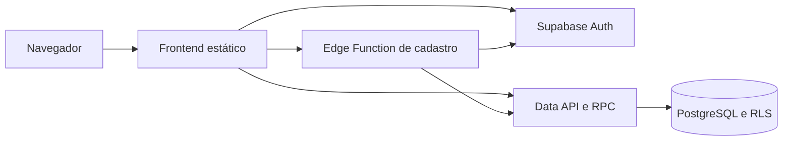

# Ótica Siciliano — documentação técnica e operacional

Revisão: **16/11/2026**. Aplicação: **https://siciliano.malstec.com.br**.

## 1. Objetivo e escopo

Centralizar o atendimento da ótica: clientes, catálogo de produtos e materiais, vendas e receita óptica, estoque, recebimentos, outras receitas/despesas, relatórios e usuários. A interface está em português e se adapta a computadores e celulares.

Esta documentação descreve o comportamento implementado. Não contém uma cópia dos registros de clientes, prescrições, credenciais ou planilhas importadas.

## 2. Arquitetura

| Componente | Tecnologia e função |
|---|---|
| Frontend | HTML, CSS e JavaScript estáticos; formulários, navegação por hash, consulta e exportação |
| Cliente de serviços | `@supabase/supabase-js@2.49.8`, carregado por esm.sh |
| Autenticação | Supabase Auth, com e-mail e senha |
| Banco | PostgreSQL no Supabase; tabelas relacionais, constraints, transações e Row Level Security (RLS) |
| Cadastro de contas | Edge Function `optical-register-user`, executada no servidor |
| Hospedagem | Sites; publica a pasta `dist` |
| Domínio/DNS | `siciliano.malstec.com.br`, com DNS no Registro.br e HTTPS ativo |

### Arquivos da implementação

| Caminho | Responsabilidade |
|---|---|
| `dist/index.html` | Estrutura da interface, login e modal |
| `dist/style.css` | Layout responsivo e cores da marca |
| `dist/app.js` | Telas, filtros, formulários e ações |
| `dist/auth.js` | Login, sessão, saída e bloqueio da interface |
| `dist/cloud.js` | Adaptador da Data API, RPCs e Edge Function |
| `dist/sales-fields.js` | Receita óptica, validação dos detalhes e composição do total |
| `dist/supabase-config.js` | URL e chave pública publishable |
| `dist/logo-siciliano.jpeg` | Logo fornecido pela empresa |
| `supabase/functions/optical-register-user/` | Serviço de criação de contas |
| `supabase/verification/` | Testes e prévia com dados fictícios |
| `.openai/hosting.json` | Identificação do projeto e configuração de publicação |

Esses caminhos descrevem o código. Um repositório exclusivamente de documentação não precisa conter os arquivos da implementação.

### Fluxo de acesso e atualização

1. A página carrega a configuração pública e o módulo de autenticação.
2. A sessão é validada com `getUser()`. O banco é consultado para confirmar um vínculo ativo em `optical_members`.
3. A interface exige exatamente uma loja ativa associada ao usuário. Ainda não há seletor de lojas para múltiplos vínculos.
4. O aplicativo carrega os registros permitidos e monta os menus do perfil.
5. Saída, mudança de sessão ou falha de autorização bloqueiam o painel.

A sessão é mantida pelo SDK no navegador. Registros operacionais são salvos no banco, não em localStorage. Cópias locais antigas podem ser exportadas para conferência, mas não são importadas automaticamente.

O adaptador carrega dados em lotes de 500 até completar as coleções permitidas. Os filtros são locais. A atualização ocorre ao entrar, voltar à aba ou clicar em **Atualizar dados**. Não há Realtime nem paginação visual; muitos registros podem aumentar o tempo de abertura.

## 3. Modelo de dados

As nove tabelas de aplicação no schema `public` possuem RLS habilitado. O schema `siciliano_private` contém o auxiliar de autorização `has_role`.

| Tabela | Campos principais e função |
|---|---|
| `optical_stores` | `id`, `name`, `created_at`; identifica a loja |
| `optical_members` | `store_id`, `user_id`, `full_name`, `role`, `active`, `created_at`; vínculo de usuário Auth com a loja |
| `optical_customers` | `id`, `store_id`, `name`, `phone`, `email`, `created_at`; clientes |
| `optical_products` | `id`, `store_id`, `name`, `material`, `category`, `price`, `stock`, `active`, `created_at`; catálogo e saldo |
| `optical_sales` | Identificação, cliente, data, situação, pagamento, total, autor, timestamps e dados complementares |
| `optical_sale_items` | `id`, `store_id`, `sale_id`, `product_id`, `product_name`, `quantity`, `line_total`; itens vendidos |
| `optical_financial_entries` | Descrição, tipo Entrada/Saída, valor, data, loja e autoria; outras receitas/despesas |
| `optical_stock_movements` | Produto, venda opcional, delta, motivo, loja e autoria; histórico de estoque |
| `optical_member_audit` | Loja, alvo, ator, perfis/situações/nomes anteriores e novos e data; alterações de acesso |

### Relacionamentos e integridade

- A loja possui clientes, produtos, vendas, movimentações e vínculos de usuários.
- Os vínculos e a auditoria referenciam a chave primária de `auth.users`.
- Uma venda pertence a um cliente e possui itens relacionados a produtos.
- Referências compostas por loja e identificador impedem associar cliente/produto/venda de outra loja.
- Cliente com venda vinculada não pode ser excluído. Produtos são desativados para preservar o histórico.
- Quantidades de itens são positivas; estoque é inteiro e não negativo; movimentação de estoque tem delta diferente de zero e motivo.
- Preço de produto informado é positivo. Preço nulo significa **Preço a definir**, e não preço zero.

Categorias de produto: `Armação`, `Lente`, `Solar`, `Acessório`, `Não informado`. Situação da venda: `Pago` ou `Pendente`. Formas de pagamento: `Pix`, `Cartão`, `Dinheiro`, `Boleto`.

### Campos complementares de vendas

As 24 colunas adicionais são opcionais e preservam as vendas antigas.

| Grupo | Campos | Validação |
|---|---|---|
| Esférico | `esferico_longe_o_d`, `esferico_longe_o_e`, `esferico_perto_o_d`, `esferico_perto_o_e` | Numeric(7,2); aceita zero e números negativos |
| Cilíndrico | `cilindrico_longe_o_d`, `cilindrico_longe_o_e`, `cilindrico_perto_o_d`, `cilindrico_perto_o_e` | Numeric(7,2); aceita zero e números negativos |
| Eixo | `eixo_longe_o_d`, `eixo_longe_o_e`, `eixo_perto_o_d`, `eixo_perto_o_e` | Inteiro de 0 a 180 |
| DNP | `dnp_o_d`, `dnp_o_e` | Numeric(7,2), positivo; informado em mm |
| Adição | `adicao` | Numeric(7,2), não negativo |
| Valores | `valor_armacao`, `valor_lente` | Numeric(12,2), não negativos; soma coincide com o total |
| Observações | `obs` | Até 4.000 caracteres |
| Categoria da venda | `categoria` | Até 120 caracteres |
| Receita própria | `receita_propia` | Booleano ou nulo; identificador preserva a grafia solicitada |
| Entrada | `data_input` | Data informada no atendimento |
| Documento | `cpf` | Texto com 11 dígitos; não consulta situação cadastral nem verifica dígitos verificadores |
| Endereçamento | `cep` | Texto com 8 dígitos |
| Nascimento | `dt_nascimento` | Data não posterior à data atual do servidor |

**VALOR_TOTAL** corresponde à coluna existente `total`. **DATA_INCLUSAO** corresponde a `created_at`, registrado automaticamente pelo servidor. **PRODUTO** permanece relacionado pelos itens. Essas informações não foram duplicadas.

CPF, CEP e nascimento são informações da venda e não atualizam automaticamente o cliente. Campos de receita vazios permanecem nulos. Esses controles validam a entrada dos dados; não interpretam nem recomendam uma prescrição.

### Funções de banco

| Função | Operação |
|---|---|
| `siciliano_private.has_role` | Confirma usuário, vínculo ativo, perfil e loja |
| `optical_create_sale` | Venda transacional básica, mantida por compatibilidade |
| `optical_create_sale_complete` | Venda com itens, receita e baixa de estoque na mesma transação |
| `optical_receive_sale` | Confirma recebimento pendente uma vez |
| `optical_adjust_stock` | Ajusta estoque e registra histórico |
| `optical_list_members` | Lista usuários da própria loja para Administrador/Gerencial |
| `optical_set_member` | Atualiza nome, perfil e situação, preservando a hierarquia |

Cada tentativa lógica de venda usa um UUID estável. Repetir esse UUID pelo mesmo autor retorna a venda existente, sem outra baixa nem substituição dos detalhes. Uma nova venda precisa de novo UUID. Qualquer erro durante a transação reverte venda, itens, receita e estoque.

## 4. Autenticação, perfis e segurança

| Ação | Administrador | Gerencial | Equipe |
|---|---|---|---|
| Clientes, Produtos e Vendas | Sim | Sim | Sim |
| Financeiro, Relatórios, Visão geral e Configurações | Sim | Sim | Não |
| Consultar usuários da loja | Sim | Sim | Não |
| Criar/alterar Administrador ou Gerencial | Sim | Não | Não |
| Criar/alterar Equipe | Sim | Sim | Não |
| Desativar/rebaixar o último administrador ativo | Não | Não | Não |

Menus e rotas são restringidos na interface. Políticas RLS, permissões de colunas e funções autorizadas fazem a restrição no banco. Usuário de uma loja não pode operar registros de outra.

Não há escrita direta do navegador em `optical_members`, nas vendas ou no histórico de estoque. As funções privilegiadas verificam a identidade e o perfil e usam `search_path` vazio. Funções de operação não podem ser executadas anonimamente.

### Cadastro de usuários

Em **Usuários → Cadastrar usuário**:

1. Informar nome completo, e-mail, perfil e situação.
2. Escolher **Criar nova conta** ou **Vincular conta existente**.
3. Para conta nova, informar e confirmar a senha inicial, com 12 a 128 caracteres. O serviço Auth pode aplicar exigências adicionais.
4. Salvar e conferir o usuário na lista.

O login continua por e-mail/senha; o nome é somente de exibição. Nenhum e-mail automático é enviado por esse fluxo. O responsável informa as credenciais ao usuário fora do aplicativo.

A Edge Function valida o JWT na plataforma e no Supabase Auth, consulta o perfil ativo e usa a chave administrativa apenas no servidor para criar a conta. O vínculo com a loja usa o JWT do solicitante e revalida as permissões no banco. Contas criadas por esse fluxo administrativo são confirmadas no Auth.

Se a conta já existir, usar o vínculo existente; esse caminho não altera sua senha. Se a criação Auth funcionar e o vínculo falhar, atualizar a lista e concluir pelo vínculo existente. A conta não recebe acesso à loja sem o vínculo ativo e não é excluída automaticamente em uma falha de rede.

### Credenciais e avisos conhecidos

- `dist/supabase-config.js` deve conter somente URL e chave pública publishable.
- Chave service role, senhas, JWTs e tokens de publicação não podem ser colocados no frontend, documentação ou repositório.
- O runtime da função usa `SUPABASE_URL` e `SUPABASE_SERVICE_ROLE_KEY`; os valores ficam no Supabase.
- A desativação de um membro bloqueia novas solicitações de dados. Dados já vistos pelo navegador não podem ser recolhidos retroativamente.
- O Advisor sinaliza funções SECURITY DEFINER acessíveis a usuários autenticados: isso é intencional nas RPCs descritas, que fazem a autorização internamente. [Referência do aviso](https://supabase.com/docs/guides/database/database-linter?lint=0029_authenticated_security_definer_function_executable).
- Na última consulta de segurança, a proteção de senhas vazadas estava desativada. [Configuração oficial](https://supabase.com/docs/guides/auth/password-security#password-strength-and-leaked-password-protection).

## 5. Manual de uso

### Clientes

Cadastrar nome e telefone e, opcionalmente, e-mail. Pesquisar por nome/contato, editar e exportar CSV. A interface exige nome e telefone; essa exigência de formulário não deve ser confundida com validação completa de telefonia no banco. Não excluir clientes com vendas vinculadas.

### Produtos

Cadastrar nome, material/variante, categoria e preço quando conhecido. Preço vazio permanece pendente. Produtos começam com estoque zero; usar **Estoque** para registrar entrada ou ajuste, sempre com motivo. Usar **Desativar** para retirar um item de novas vendas sem perder as referências anteriores.

A planilha inicial continha Produto e Material, sem preços, categorias ou quantidades. Complete esses dados para operar as vendas. O formulário de venda oferece todos os produtos ativos, inclusive sem preço cadastrado. Nesse caso, os valores começam em branco para preenchimento durante o atendimento. Para concluir a venda, é necessário informar um total positivo e ter estoque suficiente.

### Vendas e receita

1. Clicar em **Nova venda**.
2. Buscar o cliente pelo nome ou telefone e selecioná-lo. A busca mostra até 100 opções correspondentes.
3. Selecionar produto e quantidade, data, pagamento e situação.
4. Informar, quando aplicável, a receita de longe/perto para OD/OE, DNP e adição.
5. Conferir valores da armação/lente, categoria, receita própria, datas, CPF, CEP e observações.
6. Salvar e consultar pela ação **Detalhes** na listagem.

A tela registra um produto por venda. O banco suporta vários itens e os relatórios os contabilizam. O valor da armação e o da lente representam valores totais da venda, não unitários. A seleção do produto ou mudança de quantidade preenche a composição com preço × quantidade: produto da categoria Lente em valor_lente, demais categorias em valor_armacao. O operador pode ajustar a composição; o total é calculado em centavos e validado no banco.

Não há desconto separado. Receitas antigas não são preenchidas artificialmente. Para venda pendente recebida depois, usar **Receber**; não criar uma entrada financeira duplicada.

### Financeiro e relatórios

Registrar outras receitas e despesas em Financeiro. O saldo considera vendas pagas + outras entradas − saídas. Não duplicar o valor de uma venda paga como outra entrada. Filtrar por período, pesquisar e exportar relatórios em CSV ou imprimir.

Os filtros de nome e situação se aplicam às vendas; as movimentações financeiras são consideradas pelo período. O CSV de vendas/relatórios inclui os campos complementares e a data de inclusão. A busca de vendas também considera CPF, categoria e observações.

### Exportações e dados antigos

O JSON exportado é uma cópia de consulta dos dados visíveis ao perfil. Não é um backup completo do Supabase e não tem restauração automática. A opção de exportação de dados locais antigos serve à conferência e migração assistida, sem envio automático dos registros de demonstração à nuvem.

## 6. Configuração e publicação

### Banco novo

Executar uma vez, na ordem, os scripts da implementação:

1. `supabase/migrations/202611140001_siciliano.sql`
2. `supabase/roles-policy.sql`
3. `supabase/sales-details.sql`
4. `supabase/product-material.sql`
5. `supabase/user-registration.sql`

Criar o primeiro usuário no Supabase Auth, confirmar a conta e adaptar `supabase/02_primeiro_administrador.sql` ao e-mail do responsável para criar a loja e o vínculo inicial. A tela permite completar o nome posteriormente.

Não repetir os scripts em banco já atualizado. Parte das alterações iniciais foi aplicada pelo SQL Editor; não pressupor que todo o estado esteja no histórico de migrações do Supabase. Inspecionar o estado existente antes de qualquer alteração.

Publicar a função `optical-register-user` a partir da pasta correspondente, incluindo `index.ts` e `handler.mjs`, com verificação de JWT habilitada. Configurar no frontend a URL e a chave publishable do projeto correto.

### Hospedagem

O frontend não exige build. Publicar apenas a pasta `dist`, com a configuração do projeto Sites em `.openai/hosting.json`. O fluxo da hospedagem sincroniza o código, salva uma versão e publica essa versão. Preservar a audiência existente e conferir o resultado do deploy.

Documentação no GitHub é versionamento de documentos; não configura GitHub Actions, não muda a origem da hospedagem e não executa scripts SQL automaticamente.

### Domínio e identidade visual

O domínio profissional está ativo com HTTPS. No Registro.br, os nomes relativos da configuração são:

| Tipo | Nome | Destino/finalidade |
|---|---|---|
| CNAME | `siciliano` | `custom-domains.chatgpt.site.` |
| TXT | `_openai-site-verification.siciliano` | Validação da hospedagem; valor fornecido pelo projeto |
| TXT | `_cf-custom-hostname.siciliano` | Validação de domínio/certificado; valor fornecido pelo projeto |

Não copiar tokens de verificação de outro projeto. Consultar os valores no gerenciamento do domínio da hospedagem.

O logo original foi preservado no login, menu e ícone da aba. A paleta usa azul principal `#1686b7`, azul escuro `#126e9a` e verde de destaque `#87b84a`, com fundos claros. Os estilos estão em `dist/style.css`.

## 7. Importações e histórico

### Clientes

Origem: `clientes_sql.xlsx`, com 10.786 registros. Foram importados **9.695 clientes**. Separados: **946** com dados obrigatórios ou telefones inválidos/incompletos e **145** duplicatas idênticas de nome e telefone.

Telefones foram formatados com DDD 11. Foram mantidos telefones legítimos contendo zeros e excluídos números zerados ou incompatíveis com o formato aceito. Não foram inventados dígitos ausentes. O relatório local contém as linhas não importadas e os motivos; não deve ser publicado com os dados pessoais no GitHub.

### Produtos

Origem: `PRODUTOS.xlsx`, com **129 itens/variações**, sem duplicatas idênticas. Material preenchido em **112**. A origem não fornecia preço, categoria ou quantidade: preço nulo, categoria Não informado e saldo inicial zero. Nenhuma entrada de estoque fictícia foi lançada.

### Evolução funcional até esta revisão

- Primeira interface de clientes, produtos, vendas, financeiro e relatórios.
- Integração com Supabase, autenticação e RLS por loja.
- Publicação no domínio profissional e liberação pública da página de login.
- Gestão de perfis e usuários; ajuste final de Gerencial para operar somente contas de Equipe.
- Importação de clientes, receita óptica em vendas e importação de produtos/material.
- Aplicação de logo e cores da marca.
- Cadastro de contas pelo aplicativo com nome completo e login por e-mail/senha.

## 8. Validação e manutenção

### Verificações disponíveis

No código, as verificações de sintaxe usam `node --check` nos arquivos JavaScript. Testes locais específicos:

| Teste | Cobertura |
|---|---|
| `supabase/verification/check.mjs` | Migração inicial: 38 verificações de integridade e acesso |
| `supabase/verification/roles-check.mjs` | Primeira evolução de perfis: 28 verificações |
| `supabase/verification/sales-check.mjs` | Receita e vendas: 27 verificações, soma, rollback e idempotência |
| `supabase/verification/registration-check.mjs` | Cadastro atual: 19 verificações de nome, hierarquia, JWT, senha e recuperação de falhas |
| `supabase/verification/cloud-check.mjs` | Adaptador com API simulada, erros e oito telas; inclui preço nulo e material |

Os testes SQL usam PostgreSQL local PGlite 0.5.16. A dependência de teste deve ser obtida do pacote oficial e colocada em `supabase/verification/package`, conforme os scripts; não faz parte dos assets publicados. Cada suíte testa a evolução indicada, não equivale por si só a um teste completo do ambiente de produção.

Foram verificadas consultas anônimas recusadas pelo banco, função de cadastro recusando requisição sem login (HTTP 401), RLS habilitado e funções operacionais sem execução anônima. Login, menu Usuários, formulários e identidade visual foram conferidos no navegador. O formulário de receita teve o cálculo monetário conferido com dados fictícios. Nenhuma conta real foi criada automaticamente para testar o cadastro.

### Rotina operacional

- Conferir backups e possibilidades de restauração disponíveis no plano Supabase contratado. Exportação do aplicativo não substitui backup do banco.
- Revisar periodicamente vínculos, usuários inativos e histórico de alterações.
- Conferir avisos do Supabase Advisor após mudanças no banco.
- Verificar DNS, HTTPS e resultado de publicação após alterar hospedagem.
- Atualizar SDK e dependências com revisão de compatibilidade, testes e publicação controlada.
- Nunca inserir planilhas de clientes, exportações, tokens, senhas ou arquivos de sessão no repositório de documentação.

### Diagnóstico rápido

| Sintoma | Conferência |
|---|---|
| Não entra no painel | E-mail/senha, sessão, vínculo ativo e uma única loja associada |
| Usuário não aparece | Conta Auth existente, nome, vínculo na loja e atualização da lista |
| Cadastro de conta falha | Perfil autorizado, nome, e-mail, senha, função publicada e JWT; se a conta já existe, usar vínculo existente |
| Produto não aparece na venda | Conferir se está ativo e atualizar os dados |
| Venda não conclui | Estoque, cliente/produto da loja, valores, campos e erro retornado |
| Dados parecem antigos | Atualizar dados e conferir conectividade; não há Realtime |
| Tela antiga após publicação | Atualizar a página; se necessário, Ctrl+F5 |
| Domínio não abre | Registros CNAME/TXT, status da hospedagem e certificado |

## 9. Limites e evoluções possíveis

Não implementados: emissão fiscal, integração de pagamentos, disparo de aniversários, recuperação/alteração de senha pela interface, seleção de múltiplas lojas, paginação visual, Realtime, restauração de backup pela interface e edição/cancelamento de vendas já registradas. A ausência desses recursos não deve ser apresentada como funcionalidade disponível.

O cadastro de usuários usa uma senha inicial definida pelo responsável, sem convite automático. O fluxo Auth + vínculo não é uma única transação entre serviços: falha depois da criação da conta pode exigir concluir o vínculo existente. Os testes de criação foram locais com API simulada, complementados pelo bloqueio anônimo do endpoint publicado.

## 10. Referências oficiais

- [Supabase: Row Level Security](https://supabase.com/docs/guides/database/postgres/row-level-security)
- [Supabase: funções de banco](https://supabase.com/docs/guides/database/functions)
- [Supabase: criação administrativa de usuários](https://supabase.com/docs/reference/javascript/auth-admin-createuser)
- [Supabase: segurança de Edge Functions](https://supabase.com/docs/guides/functions/auth)
- [Registro.br: características técnicas de DNS](https://registro.br/tecnologia/caracteristicas-tecnicas/)

### Cadastro durante a venda e pesquisa de produtos

Na nova venda, marque **Cliente não cadastrado — cadastrar agora**, informe nome e telefone (obrigatórios) e, se disponível, e-mail. Clique em **Salvar cliente e selecionar** antes de salvar a venda. O cliente é salvo imediatamente e permanece cadastrado se a venda for cancelada. Os demais campos do atendimento são preservados. A opção está disponível aos perfis com acesso a vendas e clientes.

O campo **Buscar produto** filtra produtos ativos por nome, material/variante e categoria, desconsiderando acentos. Se não houver resultados, ajuste ou limpe a pesquisa. Produtos sem preço continuam disponíveis para informar os valores manualmente.
### Visão geral

Disponível para Administrador e Gerencial, preservando as restrições da Equipe. Exibe total de clientes, vendas do ano atual, total histórico, vendas por ano (quantidade e valor), dez últimas vendas pela data do atendimento, vendas diárias dos últimos sete dias incluindo hoje e atalhos do dia a dia. Os agrupamentos usam a data da venda, não a data de inclusão/importação. Dias sem vendas aparecem com zero; os valores diários podem ser consultados abaixo do gráfico.

O acompanhamento de um ano da última compra usa a maior data de venda de cada cliente no histórico disponível e soma exatamente um ano. Uma nova compra reinicia a contagem a partir de sua data; o aviso não se repete em todos os anos seguintes. Começa no mês atual e permite selecionar outro mês. Mostra nome, telefone, última compra, data em que completa um ano e situação (Hoje, Já completou ou A completar). Em 29/02, utiliza 28/02 no ano seguinte. Datas e períodos do painel usam America/Sao_Paulo. Não há disparo automático de mensagens.
### WhatsApp no aniversário da última compra

Na Visão geral, a lista de clientes completando um ano oferece o botão WhatsApp. O link abre uma conversa individual em nova aba, com primeiro nome do cliente, data do aniversário da última compra e convite para retornar à Ótica Siciliano. O texto é codificado em UTF-8 para preservar acentos e emojis. O número é normalizado para o formato internacional com código 55. Telefones ausentes ou inválidos mostram uma indicação sem link.

O envio é manual: o usuário revisa a mensagem no WhatsApp e clica em Enviar. Abrir o link não comprova que o cliente tem WhatsApp nem que a mensagem foi enviada. Não há disparo automático, envio em massa ou registro de envio no banco. O acesso ao recurso segue o acesso à Visão geral (Administrador e Gerencial).

### Relatórios de vendas e reativação — versão local em 18/11/2026

A seção Relatórios agora oferece duas opções, mantendo acesso de Administrador e Gerencial. Vendas no período inicia no mês atual, permite filtrar datas inclusivas, situação e busca por cliente/produto/pagamento. Mostra valor vendido, ticket médio por venda, vendas pagas, pendências, evolução mensal e detalhamento. Valores pagos são agrupados pela data da venda, não pela data de recebimento.

Clientes para reativar considera um ano de calendário ou mais após a última compra até a data de referência, incluindo quem ultrapassou o aniversário. Compras posteriores à referência não entram em consultas históricas. Uma nova compra reinicia o prazo. Clientes sem vendas registradas ficam fora da lista; 29/02 passa para 28/02 no ano seguinte. Ordenação por última compra mais antiga, busca por nome/telefone/e-mail, histórico de valores até a referência e WhatsApp manual.

Cada opção tem exportação CSV específica e estilo de impressão A4 paisagem para salvar em PDF. Todos os indicadores seguem os filtros visíveis. Os dados vêm do conjunto carregado pelo adaptador existente. Nenhuma tabela ou política remota foi alterada. Publicação autorizada pelo proprietário após revisão da versão local.

Verificação: `node supabase/verification/reports-check.cjs`, `node supabase/verification/dashboard-check.cjs` e `node supabase/verification/cloud-check.mjs`. Prévias estáticas com dados fictícios geradas na pasta outputs do workspace e conferidas no navegador; não equivalem a uma sessão autenticada real.

### Evolução dos relatórios: produtos, tendência e lista nominal

Vendas no período passa a iniciar em 1º de janeiro até a data atual. A série mensal inclui meses sem venda como zero. As barras representam o valor vendido em reais, destacando todos os meses empatados no maior valor em verde e no menor em laranja; valores iguais em toda a série mantêm cor neutra. Uma regressão linear por índice do mês traça a tendência, com comentário sobre direção, variação média em reais/mês e extremos. Um único mês não gera tendência. O comentário informa a limitação de meses parciais e não apresenta o ajuste como previsão.

Ranking: soma quantidades e valores de todos os itens de cada venda filtrada. Agrupa pelo identificador do produto, utiliza o nome atual quando disponível e preserva o nome histórico de produtos ausentes do catálogo. Seleciona os dez maiores por quantidade, desempata por valor e nome e exibe esse grupo em ordem crescente de quantidade. Produtos sem venda não entram. O botão principal exporta todos os produtos vendidos no filtro, incluindo os que não estão no top 10. Há um botão separado para exportar vendas detalhadas.

Reativação: resumo com quantidade de clientes elegíveis, botão Abrir relatório nominal para mostrar nomes e contatos e botão Fechar para recolher. O CSV exporta todos os clientes elegíveis nos filtros, independentemente da lista nominal estar aberta; não há corte de dez registros. A impressão identifica se é resumo ou nominal.

Testes adicionais: doze produtos com seleção dos dez, múltiplos itens na mesma venda, reconciliação do total dos itens, exportação de todos os produtos, 25 clientes no CSV, meses vazios, tendências de alta/queda/estável, extremos e mês único. Navegação e visual conferidos no navegador local com dados fictícios. Nenhum dado remoto foi alterado durante os testes.

### Detalhamento das vendas por dia ou mês — 19/11/2026

O detalhamento abre nas vendas do dia atual de America/Sao_Paulo, com segmentação própria por mês/ano, dia do mês e modo Por dia ou Por mês. O botão Hoje retorna à data atual. A troca de mês preserva o número do dia quando possível e limita ao último dia válido, incluindo fevereiro bissexto. Esses controles não alteram os gráficos e indicadores gerais do período.

A seção destaca clientes novos, clientes únicos atendidos, quantidade de vendas e valor vendido na seleção. Novo significa primeira compra registrada em todo o histórico carregado, ocorrida no dia ou mês selecionado. Uma pessoa com várias vendas é contada uma vez. Compradores com histórico anterior não entram como novos. A classificação depende da cobertura do histórico disponível, não da data de cadastro.

A exportação de vendas detalhadas sempre contém todas as vendas do mês/ano selecionado no detalhamento, mesmo no modo diário. Inclui todas as situações e clientes do mês; não aplica pesquisa/situação/período dos controles gerais nem limita ao dia exibido. O nome do arquivo identifica o mês. Colunas: código da venda, cliente, produto, quantidade, data, valor, situação, pagamento, primeira compra registrada e indicação de cliente novo no mês. A exportação de produtos e a de clientes para reativar mantêm seus filtros anteriores.

Verificações: limites de dia/mês/ano, recompra, cliente novo único, total em centavos, dia vazio, CSV mensal completo, fevereiro de 28/29 dias e botão Hoje. Teste integrado verifica que o CSV contém vendas antes e depois do dia escolhido no mesmo mês, ignora os filtros gerais e exclui o mês seguinte.

### Detalhamento diário/mensal e clientes novos — 19/11/2026

O bloco Detalhamento das vendas inicia no dia atual em America/Sao_Paulo. Oferece Por dia e Por mês, seleção de mês/ano, seletor de dia e botão Hoje. Trocar de mês preserva o número do dia quando possível e ajusta para o último dia válido quando necessário (por exemplo, 31/01 → 28/02 em ano não bissexto). O detalhamento usa seu próprio recorte temporal, sem os filtros gerais do gráfico/ranking.

Indicadores do recorte: clientes novos, clientes únicos atendidos, quantidade de vendas e valor vendido. Cliente novo é quem tem a primeira compra registrada em todo o histórico disponível dentro do dia ou mês escolhido; compras repetidas não duplicam a contagem. Identificação visual Novo no dia/Novo no mês na tabela.

A exportação de vendas detalhadas, tanto no topo quanto no bloco, passa a exportar todas as vendas do mês/ano selecionado, incluindo outros dias, clientes e situações. Inclui código da venda, nome, produto, quantidade, data, total, situação, pagamento, primeira compra registrada e indicador de cliente novo no mês. O arquivo inclui o mês no nome. A exportação de produtos e de clientes para reativar permanece com os critérios anteriores.

Verificação adicional: contagem única de cliente com compras repetidas, retorno de cliente antigo, cliente novo no dia/mês, dia sem venda, exclusão de outro mês, limites de fevereiro/ano bissexto, botão Hoje e exportação mensal completa mesmo com filtros gerais restritivos. Alternância e indicadores conferidos no navegador com dados fictícios.

### Classificação de produtos por valor — 19/11/2026

O ranking seleciona os dez produtos com maior valor total vendido e os apresenta do maior para o menor. As barras também usam valor vendido. Quantidades permanecem visíveis como informação complementar. O CSV inclui todos os produtos vendidos nos filtros, na mesma ordem decrescente de valor; empates são resolvidos por quantidade e nome. Esta regra substitui a classificação anterior por quantidade crescente.

### Gráfico somente com meses fechados — 19/11/2026

O gráfico mensal, extremos, tabela mensal, regressão e comentário agora utilizam apenas meses completos dentro do período escolhido e anteriores ao mês atual em America/Sao_Paulo. O começo parcial é avançado ao próximo dia 1; o fim parcial é recuado ao último dia do mês anterior. O mês atual fica fora mesmo se a data final estiver no futuro. Exibe o intervalo efetivamente analisado e uma mensagem quando não há mês fechado. Os indicadores gerais, ranking, detalhamento diário/mensal e exportações mantêm seus próprios filtros e períodos. Testes cobrem mês atual, virada do ano, fevereiro bissexto e limites parciais.

### Reativação após dois anos — 19/11/2026

O relatório Clientes para reativar passa a incluir clientes com dois anos de calendário ou mais desde a última compra até a data de referência. Quantidade, lista nominal, CSV (coluna Completa dois anos), textos e WhatsApp usam o prazo de dois anos. Uma nova compra reinicia o prazo. Em 29/02, usa-se 28/02 no ano-alvo quando necessário. O acompanhamento de aniversário de um ano na Visão geral mantém sua regra própria; a mensagem compartilhada aceita prazo parametrizado, com padrão de um ano e dois anos na reativação. Testes de limite exato, dia anterior, recompra, consulta histórica, ano bissexto e mensagem aprovados.

### Detalhamento do valor de vendas históricas — 19/11/2026

Em Clientes para reativar, o indicador Vendas históricas oferece Detalhar valor histórico. A seleção usa os clientes elegíveis (dois anos ou mais sem comprar), a pesquisa e a data de referência atuais. O painel mostra o valor total, quantidade de clientes únicos, número de vendas, produtos distintos, intervalo da primeira à última venda, valores por mês, participação por cliente, ranking por unidades e valor por produto e todas as transações que formam o total. Destaca os líderes em unidades e valor, incluindo empates. Valores incluem vendas pagas e pendentes; não representam apenas recebimentos nem uma previsão de faturamento recuperável.

O botão Exportar histórico completo baixa uma linha por venda de todo esse histórico, com código, cliente, data, produto(s), quantidade, valor total, situação e pagamento. O total é somado por venda, sem duplicação por itens. Há impressão/PDF quando o painel está aberto. Testes reconciliam valores por cliente, mês e produto e o total do indicador, além de consulta histórica, pesquisa, exclusão de compras posteriores e CSV.

### Cadastros em caixa alta — 19/11/2026

Nomes de clientes, nomes de produtos e material/variante são convertidos para caixa alta com suporte a acentos pt-BR. A conversão acontece durante a digitação/colagem e novamente antes da gravação no adaptador, cobrindo novos cadastros e edições. O cadastro de cliente dentro da venda segue a mesma regra e mantém a seleção local com o nome em caixa alta. E-mail, telefone, números, preços, senhas e usuários permanecem com o tratamento anterior. Rótulos das categorias na seleção aparecem em caixa alta; os valores internos da categoria permanecem no formato previsto pelo banco. Registros antigos são padronizados quando editados; não há alteração em massa dos dados históricos.

Verificações: inserção e edição, acentos, material, preço pendente, preservação dos campos técnicos, posição do cursor e cadastro rápido na venda. As regras de autorização e o esquema do banco não foram alterados.
